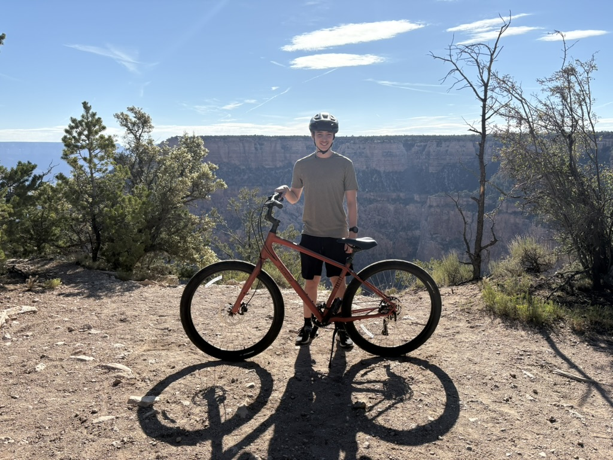

# Samuel Aibel: Web Designer Profile



## About Me

My name is **Samuel Aibel**, and I am a student at SUNY New Paltz. I am enrolled in Web Page Design for the fall semester.

Outside of class, I like *running, playing pickleball, and traveling*. I used to be into ~~cycling~~, but got bored of it after 3000 miles. My favorite tool is `[Visual Studio Code]`.

## My Lack of Technical Background

I gained some rudimentary knowledge of Python from a course I took in 10th grade but forgot almost all of it.

### Skills and Tools

- **HTML**: Beginner
- **CSS**: Beginner

### Steps to Master Web Design

1. Learn the structure of an HTML page and familiarize myself with the language
2. Practice styling pages with CSS
3. Become comfortable with the tools offered by Visual Studio Code
4. Build a multi-page website from scratch

### Semester Milestones

- [x] Set up VS Code
- [x] Create a GitHub account
- [x] Finish my Markdown profile
- [ ] Build my first multi-page website from scratch

## Code That Represents Me

```html
<!DOCTYPE html>
<html lang="en">
<head>
  <title>Samuel Aibel</title>
</head>
<body>
  <h1>Hello, I'm Samuel Aibel!</h1>
  <p>Future web designer</p>
</body>
</html>
```

## Favorite Quote

> "Any fool can know. The point is to understand."
>
> — Albert Einstein

## My Info

- [My GitHub profile](https://github.com/samuelaibel)
- [A site I visit a lot](https://www.espn.com/)

